<div align="center">
  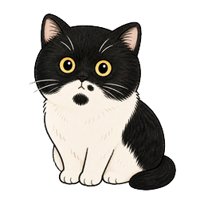
  <h1>Hachimi Pet (`hachimi-pet`)</h1>
  <p><strong>轻量级 Antigravity 桌面伴侣插件（自定义猫猫魔改版 · 完整源码 + 即装插件包）</strong></p>

  <p>
    <a href="./LICENSE"></a>
    
    
    
  </p>
</div>

---

> [!NOTE]
> **Fork 与致谢说明**：本仓库（[Esmeralda-11/hachimi-pet](https://github.com/Esmeralda-11/hachimi-pet)）是基于原作者 **[hwt675217/hachimi-pet](https://github.com/hwt675217/hachimi-pet)**（`v1.0.0`）的个人定制派生版（Fork）。感谢原作者在桌宠框架、多智能体状态同步与插件架构上的设计及实现。本仓库遵循与上游一致的 **GNU Affero General Public License v3.0 or later（`AGPL-3.0-or-later`）** 开源协议，完整保留原有许可证（[`LICENSE`](./LICENSE)）与第三方声明（[`hachimi-pet/THIRD_PARTY_NOTICES.md`](./hachimi-pet/THIRD_PARTY_NOTICES.md)）。
>
> - **原版上游仓库**：[https://github.com/hwt675217/hachimi-pet](https://github.com/hwt675217/hachimi-pet)
> - **本定制 Fork 仓库**：[https://github.com/Esmeralda-11/hachimi-pet](https://github.com/Esmeralda-11/hachimi-pet)

---

## 实机动作展示 · 我家猫猫们

每只猫在桌面上都会随着 Antigravity 的对话、思考、读取、奔跑、报错、休眠与视线追踪切换专属动画：

<div align="center">
  <table>
    <tr>
      <td align="center" width="25%">
        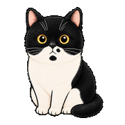<br />
        <strong>22</strong><br />
        <sub>慢眨眼打招呼</sub>
      </td>
      <td align="center" width="25%">
        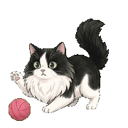<br />
        <strong>奶牛</strong><br />
        <sub>工作 · 拨毛线</sub>
      </td>
      <td align="center" width="25%">
        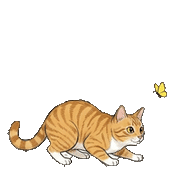<br />
        <strong>黄</strong><br />
        <sub>奔跑 · 追蝴蝶</sub>
      </td>
      <td align="center" width="25%">
        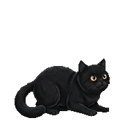<br />
        <strong>黑</strong><br />
        <sub>跳跃腾空</sub>
      </td>
    </tr>
  </table>
  <table>
    <tr>
      <td align="center" width="33%">
        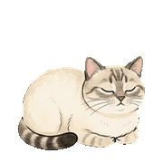<br />
        <strong>汤圆</strong><br />
        <sub>等待 · 休眠打盹</sub>
      </td>
      <td align="center" width="33%">
        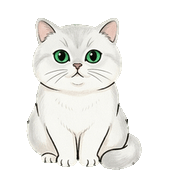<br />
        <strong>阿扁</strong><br />
        <sub>报错 · 歪头疑惑</sub>
      </td>
      <td align="center" width="33%">
        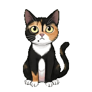<br />
        <strong>大黑</strong><br />
        <sub>360° 视线跟随</sub>
      </td>
    </tr>
  </table>
</div>

> 以上动图为作者本地自建角色包的实机展示效果；为保护个人素材，本仓库仅含精简展示预览图，**不包含**该角色包的精灵图集、原照或可导出的本地数据包。

---

## 本地设置工坊界面一览

通过系统顶部状态栏「设置…」或直接访问本地工坊页面（`http://127.0.0.1:17890/workshop`），可一站式管理角色包、调节尺寸与模式、导入多视角照片并逐帧检视修改动作：

<div align="center">
  <p>
    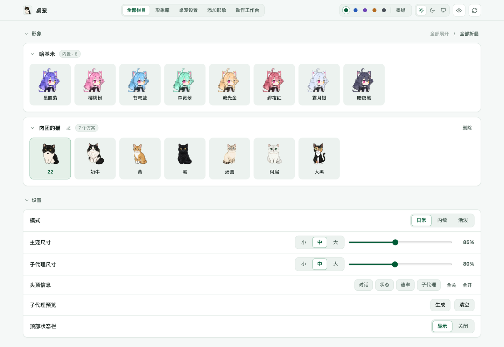
    <br />
    <sub>浅色模式 · 形象库管理、模式/尺寸/头顶提示与顶部状态栏开关</sub>
  </p>
  <p>
    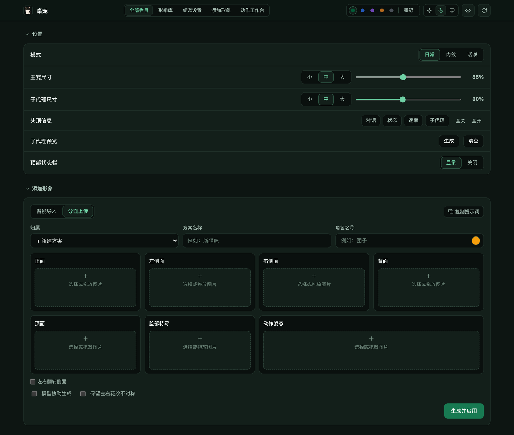
    <br />
    <sub>深色模式 · 智能导入与 7 视角分面上传面板</sub>
  </p>
  <p>
    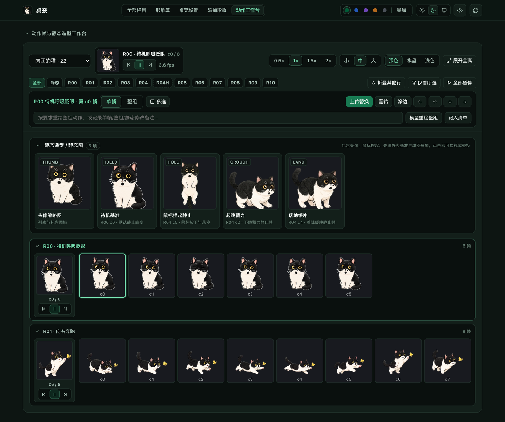
    <br />
    <sub>动作帧与静态造型工作台 · 固定控制栏、静态造型卡与逐帧实时预览</sub>
  </p>
</div>

---

## 本 Fork 主要增强与改动

在原版 `v1.0.0` 基础上，本派生分支补充了以下定制功能与修复：

- **自定义角色包与本地设置工坊（本地工坊页面 `/workshop`）**：支持本地自定义精灵图集导入、多角度/分面图片导入与自动抠图切帧、逐帧检视预览，以及极简亮暗双模与多主题色系设置页。
- **子代理与蜂群精确联动修复**：修正桌面子代理数量与实际运行中子代理/蜂群成员的对应关系，任务结束后干净退场。
- **状态栏与桌面交互优化**：5 段式状态栏菜单重排，新增「关闭状态栏」与右键桌面宠物呼出完整菜单恢复；支持主宠与子代理独立大中小尺寸调节、性格模式（活泼 / 日常 / 内敛）及头顶 4 项提示独立开关，并优化 macOS 状态栏图标居中与留白效果。

### 适用范围与不含内容

- **适用平台**：本分支新增的托盘菜单、右键菜单与本地工坊功能主要在 **macOS（Electron 运行时）** 下测试迭代；Windows 原生 WebView2 轻壳（源码目录 `shell-win32`）暂未同步新增托盘项，Windows 用户如需原版体验请直接参考上游仓库 [hwt675217/hachimi-pet](https://github.com/hwt675217/hachimi-pet)。
- **不含私有素材数据包**：本仓库**不包含任何个人私有宠物数据包、原照或精灵图集**（仅含上方 README 展示用小尺寸预览图），安装后默认使用上游原版哈基米形象；自定义角色包存放在用户本地角色包目录 `~/.hachimi-pet/packs/` 下。
- **可选 Python 依赖**：若需使用本地设置工坊（`/workshop`）的「智能导入 / 分面多图切帧」功能，需本机 Python 已安装图像处理依赖 `pillow`、`numpy`、`scipy`（安装命令 `pip install pillow numpy scipy`），macOS 14+ 会自动优先调用系统 Apple Vision 抠图；仅使用内置形象或已打包图集无需上述 Python 依赖。

---

## 📁 仓库结构 · Repository Structure

本仓库包含**可直接安装的便携插件包**与**完整可编译源代码**：

| 目录 | 说明 |
| :--- | :--- |
| [`hachimi-pet/`](./hachimi-pet/) | **Antigravity 插件本体（~9.9 MB）**：包含 `plugin.json`、`hooks.json`、`mcp_config.json`、`skills/hachimi/`、`rules/AGENTS.md`、Windows 原生 WebView2 轻壳与打包产物，可直接安装使用 |
| [`agy-hachimi-pet/`](./agy-hachimi-pet/) | **完整源码工程**：React + TypeScript + Vite 前端（`src/`）、Node.js 桥接与目录/遥测监听引擎（`electron/`）、Windows 原生 WebView2 透明壳源码（`shell-win32/HachimiPetShell.cs`）、哈基米骨骼模型与 8 套配色资产（`public/`） |

---

## 🚀 快速安装（插件本体）

以下命令拉取的是本定制 Fork 仓库（[Esmeralda-11/hachimi-pet](https://github.com/Esmeralda-11/hachimi-pet)）；如需安装原版，请将克隆地址替换为上游仓库 [hwt675217/hachimi-pet](https://github.com/hwt675217/hachimi-pet)。

### 方式一：通过 Antigravity CLI 安装（推荐）
```bash
git clone https://github.com/Esmeralda-11/hachimi-pet.git
cd hachimi-pet
agy plugin validate ./hachimi-pet --strict
agy plugin install ./hachimi-pet
```

### 方式二：手动复制到全局插件目录

**Windows (PowerShell):**
```powershell
git clone https://github.com/Esmeralda-11/hachimi-pet.git "$env:TEMP\hachimi-pet-repo"
Copy-Item -Recurse -Force "$env:TEMP\hachimi-pet-repo\hachimi-pet" "$HOME\.gemini\config\plugins\hachimi-pet"
```

**macOS / Linux:**
```bash
git clone https://github.com/Esmeralda-11/hachimi-pet.git /tmp/hachimi-pet-repo
mkdir -p ~/.gemini/config/plugins
cp -R /tmp/hachimi-pet-repo/hachimi-pet ~/.gemini/config/plugins/hachimi-pet
```

安装完成后，在 Antigravity 对话框输入 **`/hachimi`** 即可唤醒桌宠。

---

## 🛠️ 从源码编译打包

```bash
cd agy-hachimi-pet
npm install
npm run dev           # 启动 Vite + 桌面端开发调试
npm run build:plugin  # 编译前端并同步输出到 ../hachimi-pet/app/
```

Windows 原生 WebView2 轻壳源码位于 [`agy-hachimi-pet/shell-win32/HachimiPetShell.cs`](./agy-hachimi-pet/shell-win32/HachimiPetShell.cs)，可直接使用系统自带 `.NET Framework 4.x` (`csc.exe`) 编译。

详细特性列表、系统托盘菜单与运行环境要求请参阅 [`hachimi-pet/README.md`](./hachimi-pet/README.md)。

---

## 📄 开源协议与致谢 · License & Attribution

- 本项目遵循 **GNU Affero General Public License v3.0 or later (`AGPL-3.0-or-later`)**，详见 [`LICENSE`](./LICENSE) 与 [`hachimi-pet/THIRD_PARTY_NOTICES.md`](./hachimi-pet/THIRD_PARTY_NOTICES.md)。
- 上游原版项目为 **[hwt675217/hachimi-pet](https://github.com/hwt675217/hachimi-pet)**（`v1.0.0`），本仓库（[Esmeralda-11/hachimi-pet](https://github.com/Esmeralda-11/hachimi-pet)）为其个人定制派生版，完整延续原版开源协议与第三方版权声明。
